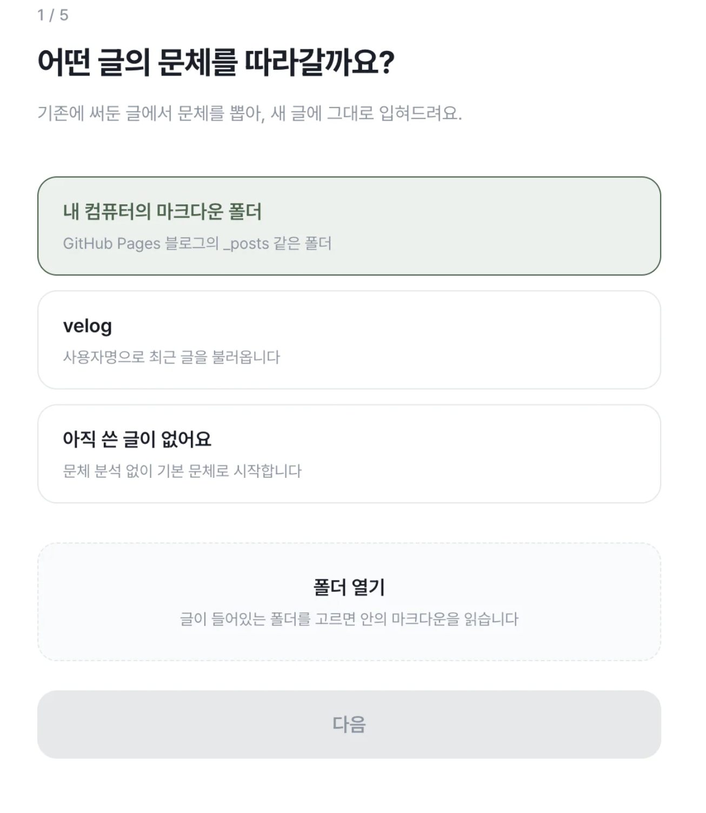
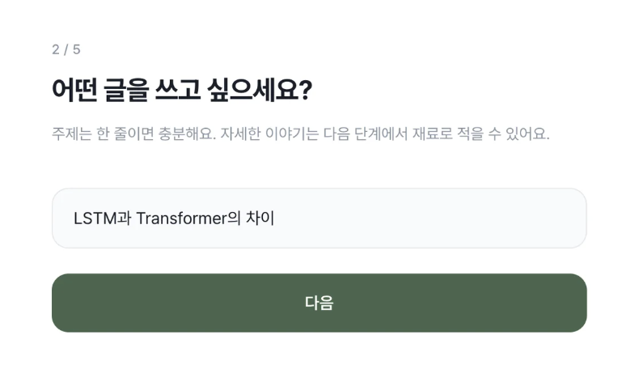
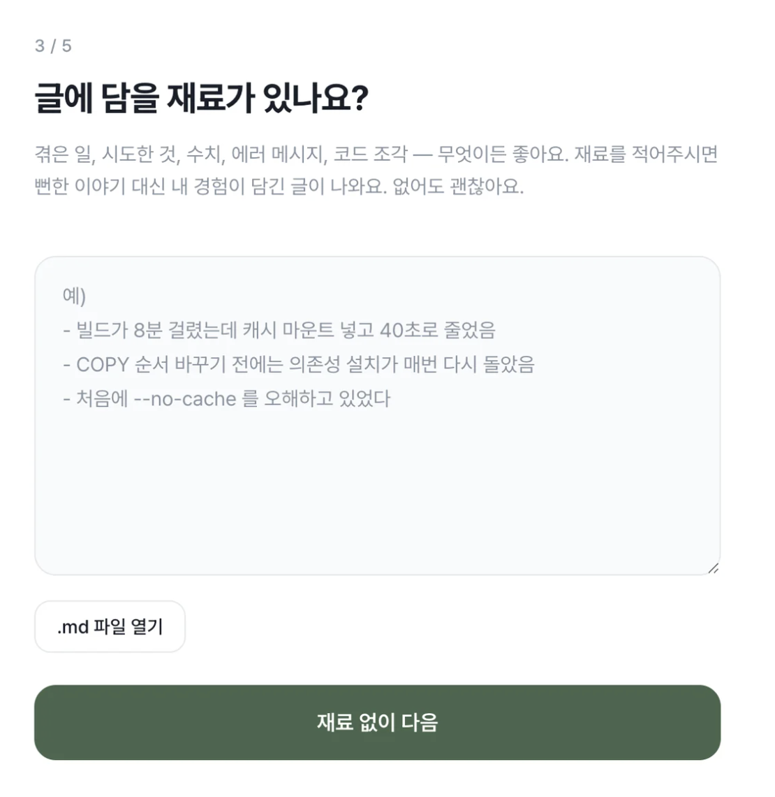
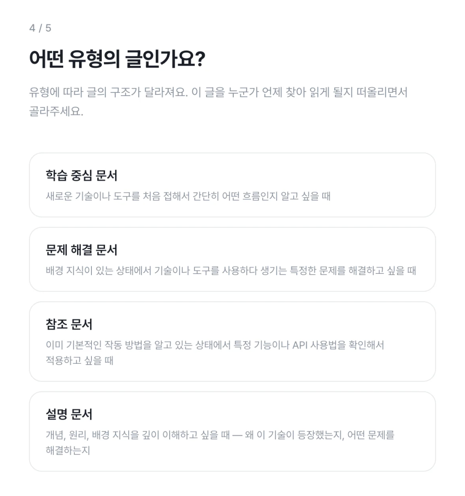
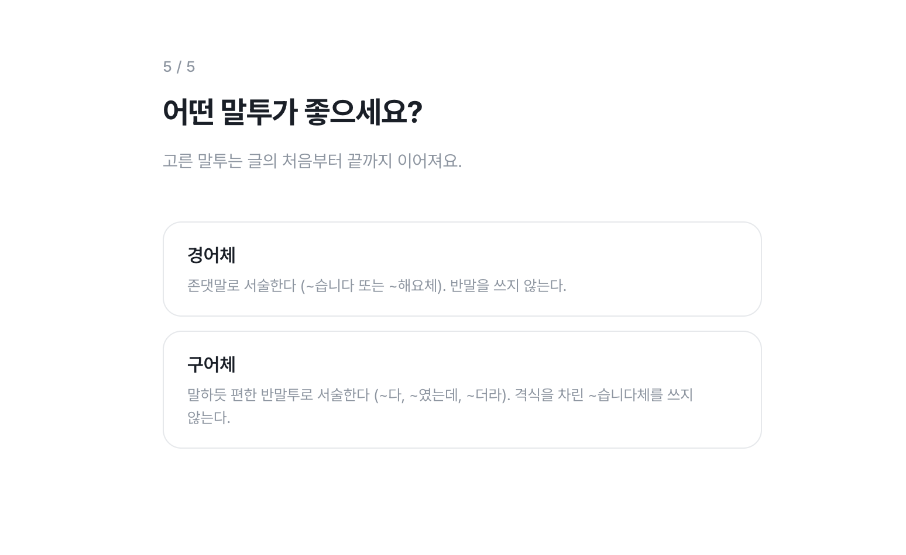
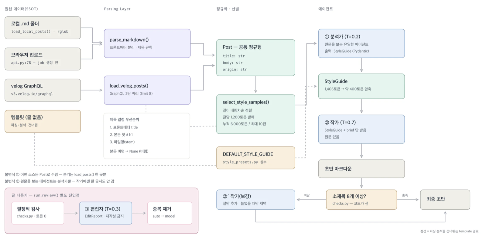
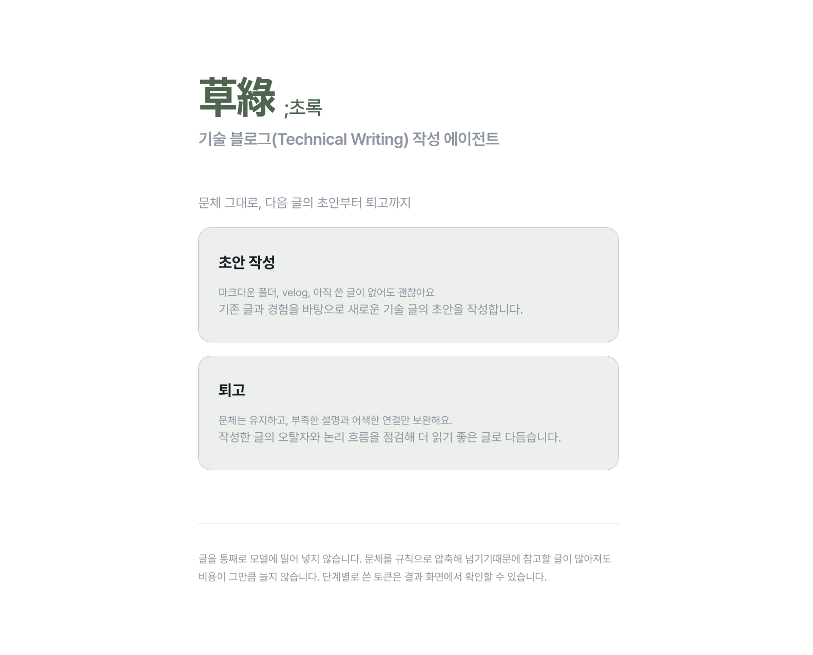
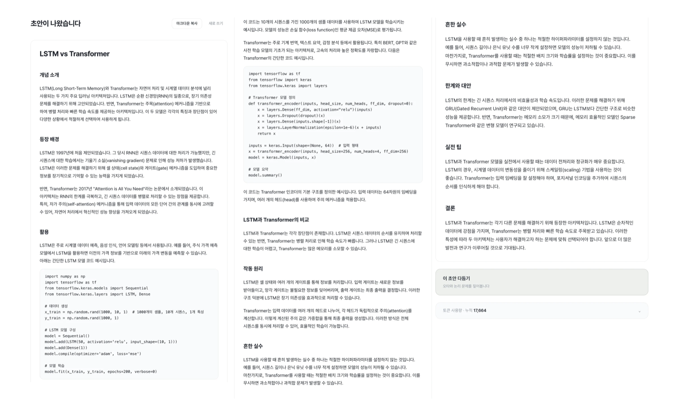

## 들어가며

필자는 기술 블로그에 글을 쓰며 여러 어려움을 겪곤 합니다. 글에 많은 것을 담고 싶은 마음에 내용만 고민하다 지치기도 하고, 기존 글과 문체가 달라질까 걱정되어 첫 문장조차 떼지 못하기도 합니다. 도움을 받아 보려 글감을 LLM에 넣어도 필자의 문체와 맥락을 이해하지 못한 글이 돌아와, 그대로 쓰기는 어려운 경우가 많았습니다.

초록(Cho-log)은 이런 글쓰기의 부담을 조금이나마 줄이기 위해 시작한 프로젝트입니다. 사용자가 글감을 입력하면 멀티 에이전트가 기존 글에서 문체를 읽어 초안을 만들어주고, 이미 작성해 둔 글은 고쳐야 할 부분을 짚어주는 웹 서비스로 기획했습니다.

이번 글에서는 초록을 왜, 어떻게 만들게 되었는지와 사용자가 초록을 통해 무엇을 경험할 수 있는지 정리하고자 합니다.

## 문제 정의

### 글쓰기를 시작하는 어려움

개발이나 학습을 하고 나면 글의 재료는 남습니다. 마주친 에러 메시지, 수정한 코드, 여러 방법 중 무엇을 선택했는지, 그 결과를 측정한 기록 같은 것들입니다. 하지만 이것들을 그대로 나열한다고 해서 하나의 글이 되지는 않습니다.

예를 들어 캐시를 적용한 경험을 쓴다면, 캐시를 적용한 코드를 보여주기 전에 어떤 요청이 반복되었고 왜 기존 방식으로는 부족했는지 설명해야 합니다. 그다음에는 캐시를 어떻게 적용했고 무엇이 달라졌는지까지 이어야 합니다. 쓸 내용이 없는 것과, 가진 내용을 어떤 순서로 풀어낼지 정하지 못하는 것은 다른 문제입니다.

사용자에게 글감이 없는 경우는 많지 않습니다. 어려움을 겪는 지점은 이 글감을 글의 흐름으로 구성하는 일입니다.

### AI에 맥락과 문체를 전달하는 어려움

그래서 초안이나 글의 방향을 얻기 위해 생성형 AI에 주제를 전달하기도 합니다. 하지만 "캐시 도입기를 작성해줘"라는 요청만으로는 필자가 왜 캐시를 적용했는지까지 알 수 없습니다. 이 정보가 없으면 프로젝트에서 겪은 경험보다 캐시에 대한 일반적인 설명이 중심이 됩니다.

문체와 설명 방식도 함께 전달해야 합니다. 평소 어떤 표현을 사용하고 문제 상황과 코드를 어떤 순서로 배치하는지에 따라, 같은 내용도 다르게 읽히기 때문입니다. 그런데 새 글을 쓸 때마다 기존 글을 붙여 넣고 이런 조건을 매번 설명해야 한다면, 초안을 얻는 과정에 또 다른 반복 작업이 남습니다.

결국 사용자는 자신의 맥락과 문체를 매번 설명하는 수고를 감당하거나, 그렇지 않으면 자신의 글과 어긋난 초안을 받게 됩니다.

### 작성한 글을 스스로 검토하는 어려움

초안을 작성한 뒤에도 글쓰기는 끝나지 않습니다. 작성자는 이미 문제의 맥락을 알고 있기 때문에 설명을 생략해도 자연스럽게 읽힙니다. 하지만 처음 읽는 사람에게는 용어가 갑자기 등장하거나, 근거 없이 결론으로 넘어가는 글이 될 수 있습니다.

이때 글 전체를 다시 작성한 결과만 받으면, 원문과 대조하며 어디가 왜 바뀌었는지 직접 찾아야 합니다.

사용자는 이렇게 문제가 있는 위치와 이유를 스스로 짚고 무엇을 고칠지까지 판단해야 하는 퇴고 과정에서 피로를 느낍니다.

## 요구사항 정의

위의 불편함을 바탕으로 사용자가 도움을 필요로 하는 시점을 두 가지로 나눴습니다.

1. 쓸 재료는 있지만 아직 글의 형태로 정리하지 못한 시점
2. 글은 작성했지만 오탈자와 설명의 흐름을 점검하고 싶은 시점

첫 번째에는 기존 문체와 글감을 바탕으로 초안을 제공하고, 두 번째에는 작성한 원문에서 수정할 부분을 알려주기로 했습니다. 두 시점은 서로 이어져 있지 않으므로, 어느 쪽으로 들어오든 필요한 기능만 쓸 수 있어야 한다고 보았습니다.

요구사항의 기준은 **글을 시작하는 부담을 줄이면서, 사용자의 경험과 최종 판단이 글에 남도록 하는 것**이었습니다. 사용자는 자신이 겪은 일을 제공하고, 초록은 이를 구성하거나 점검하는 일을 돕도록 역할을 정했습니다.

## 문제들을 어떻게 해결했는가

요구사항을 기능으로 옮기면서 세 가지를 차례로 정해야 했습니다. 사용자의 문체를 어떻게 확보할 것인지, 사용자가 겪은 일을 어떤 형태로 받을 것인지, 그리고 이 둘을 어떤 순서로 처리해서 초안과 지적 목록을 만들 것인지입니다.

### 필자의 기존 글을 문체의 재료로

앞에서 짚은 어려움 중 하나는 새 글을 쓸 때마다 기존 글을 붙여 넣고 자신의 말투를 설명해야 한다는 점이었습니다. 이 설명을 사용자가 아니라 초록이 하도록 옮기는 것이 첫 번째 과제였습니다.

먼저 기존 글을 가져오는 경로를 세 가지로 두었습니다. 로컬 마크다운 폴더, 브라우저에서 고른 폴더 업로드, velog 사용자명입니다. 사용자가 평소 글을 두는 곳에서 바로 불러올 수 있어야 한다고 보았기 때문입니다.

{: width="480" style="display:block;margin:2rem auto"}

세 경로는 읽는 방법이 서로 다르지만, 모두 제목과 본문으로 이루어진 하나의 글 형태로 수렴하도록 했습니다. 소스가 갈라지는 지점을 로더 한 곳에 모아두면 뒤따르는 분석과 작성 단계는 글이 어디서 왔는지 알 필요가 없습니다. 실제로 velog는 공개 API가 아니어서 개발 도중 쿼리 인자 형태가 한 번 바뀌었는데, 이 변경은 velog 로더 안에서 끝났고 나머지 단계는 건드리지 않아도 되었습니다.

가져온 글은 원문 그대로 다음 단계로 넘기지 않았습니다. 대신 분석가 에이전트가 어투와 문장 종결 어미, 문단당 문장 수, 소제목의 형태, 코드 예시의 비중, 자주 쓰는 표현, 전개 순서를 읽어 문체 규칙으로 정리하도록 했습니다. 이때 '친근하다'처럼 평가하는 표현 대신, `~습니다체를 기본으로 쓰되 문단 끝에서만 ~죠로 끝낸다`처럼 다른 사람이 그대로 따라 할 수 있는 문장으로 적게 했습니다. 규칙이 구체적이지 않으면 다음 단계에서 지킬 수가 없기 때문입니다.

원문 대신 규칙으로 압축한 이유는 두 가지입니다. 프롬프트에 넣은 토큰은 그대로 비용이 되고, 프롬프트가 길어질수록 정작 지켜야 할 지시가 묻힙니다. 특히 한국어는 같은 뜻의 영어 문장보다 토큰이 더 듭니다. 토크나이저의 어휘가 영어 중심으로 만들어져 한글이 여러 조각으로 쪼개지기 때문입니다. 한 번의 실행에서 샘플 1,406토큰이 약 400토큰의 문체 규칙으로 줄었습니다.

### 일반론보다는 경험을 담은 글감을 바탕으로

"캐시 도입기를 작성해줘"라는 요청만으로는 필자가 왜 캐시를 적용했는지 알 수 없다는 점도 앞에서 짚었습니다. 문체를 맞춰도 내용이 일반적인 설명이면 사용자의 글이 되지 않습니다.

그래서 주제는 한 줄로만 받고, 자세한 이야기는 다음 단계에서 글감으로 적도록 나눴습니다. 겪은 일, 시도한 것, 수치, 에러 메시지, 코드 조각처럼 아직 문장으로 정리되지 않은 재료를 그대로 적을 수 있게 한 것입니다.

  <figure style="flex:1 1 260px;margin:0">
    
    <figcaption style="margin-top:.6rem;font-size:.78rem;color:#777;text-align:center;line-height:1.4">주제는 한 줄이면 충분합니다</figcaption>
  </figure>
  <figure style="flex:1 1 260px;margin:0">
    
    <figcaption style="margin-top:.6rem;font-size:.78rem;color:#777;text-align:center;line-height:1.4">겪은 일과 수치는 다음 단계에서 받습니다</figcaption>
  </figure>

입력한 재료는 작가 프롬프트에 그대로 실리고, 본문 내용의 최우선 출처로 지정했습니다. 재료와 일반 지식이 어긋나면 재료를 따르도록 했고, 재료에 담긴 수치나 에러 메시지는 뭉뚱그려 요약하지 말고 본문에 실제로 쓰도록 했습니다. 또한 어느 절에도 들어가지 못한 재료가 남으면 그 재료를 위한 절을 만들도록 했습니다. 사용자가 적어 넣은 것이 글에서 빠지지 않게 하려는 것입니다.

내용이 정해져도 배치할 순서는 남습니다. 오류를 해결한 경험이라면 문제와 원인이 앞에 와야 하고, 처음 학습한 기술을 소개한다면 목표와 따라갈 순서가 앞에 와야 합니다. 이를 위해 학습 중심, 문제 해결, 참조, 설명의 네 가지 문서 유형을 두고 유형마다 섹션 골격을 준비했습니다. 유형을 나누는 기준과 각 유형에 어떤 항목이 들어가야 하는지는 [토스 테크니컬 라이팅 가이드](https://technical-writing.dev/type/index.html)를 참고했습니다. 학습 중심 문서라면 목표와 사전 요구사항, 단계별 가이드, 최종 결과 확인이 들어가고, 참조 문서라면 개요와 속성 표, 시그니처, 반환 값, 사용 예시가 들어갑니다. 이 골격을 그대로 작가 프롬프트에 실어, 대괄호로 표시된 안내를 실제 내용으로 바꿔 쓰도록 했습니다.

{: width="520" style="display:block;margin:2rem auto"}

독자를 따로 묻지 않은 이유도 여기에 있습니다. 학습 중심 문서를 찾는 사람은 그 기술을 처음 접하는 사람이고, 참조 문서를 찾는 사람은 이미 쓸 줄 아는 사람입니다. 누가 읽는가는 이미 유형에 담겨 있으므로 사용자에게 던지는 질문을 하나 줄였습니다. 대신 말투는 글 전체의 인상을 좌우하므로 경어체와 구어체 중에서 직접 고르도록 남겼습니다.

{: width="760" style="display:block;margin:2rem auto"}

분량은 글자 수로 받지 않았습니다. 대신 문서 유형의 템플릿과 소제목 최소 8개라는 기준이 길이를 정하도록 했습니다. 다만 프롬프트로 개수를 지시해도 모델이 자주 틀렸습니다. 그래서 소제목 개수는 코드로 세고, 모자라면 절을 더하는 보강 단계를 한 번만 더 실행하도록 했습니다. 이때 처음부터 다시 쓰게 하지 않고 기존 본문은 그대로 둔 채 절만 더하게 했으며, 보강한 결과가 조건을 더 잘 지켰을 때만 채택합니다.

정리하면 기존 글은 어떻게 쓸지를, 새로 입력한 재료는 무엇을 쓸지를, 문서 유형은 어떤 순서로 쓸지를 각각 맡습니다.

### 멀티 에이전트를 설계하여 (분석가, 작가, 편집자)

문체 분석과 초안 작성과 원고 검토를 하나의 프롬프트에 몰아넣지 않은 이유가 있습니다. 문체 분석은 이미 있는 것을 측정하는 일이고, 초안 작성은 없는 것을 만드는 일이며, 검토는 어긋난 곳을 찾는 일입니다. 요구되는 성격이 서로 다른데 한 번에 시키면 지시가 길어지고, 길어진 만큼 각 지시가 서로 희석됩니다.

그래서 백엔드는 Python과 FastAPI로 구성하고 CrewAI로 세 에이전트를 나눴습니다. 역할에 따라 온도도 다르게 두었습니다. 측정을 맡은 분석가는 0.2, 초안을 쓰는 작가는 0.7, 지적을 내는 편집자는 0.3입니다.

**

*이미지를 누르면 원본 크기로 볼 수 있습니다.*

나눠서 얻은 것이 하나 더 있습니다. 작가에게는 문체 규칙과 글 요청만 전달하고 기존 글 원문은 넘기지 않습니다. 작가는 그 문체가 로컬 폴더에서 왔는지 velog에서 왔는지조차 알지 못합니다. 원문을 보는 에이전트는 분석가 하나뿐입니다. 사용자의 기존 글이 그대로 새 글에 섞여 들어가지 않도록 경계를 둔 것입니다.

각 에이전트의 지시에는 무엇을 관찰하고 무엇을 결정할지를 절차로 적었습니다. 분석가에게는 측정할 항목을 나열한 뒤 인상이 아니라 실제 문장을 근거로 확인하게 했고, 작가에게는 소제목 뼈대를 먼저 잡고 개수를 센 다음 본문을 채우게 했습니다. 지시가 서로 어긋날 때를 대비해 우선순위도 함께 적었습니다. 구조는 문서 유형이, 말투는 사용자가 고른 값이, 나머지 어휘와 문단 길이는 문체 규칙이 이깁니다.

단계마다 Crew를 따로 실행한 것도 의도한 선택입니다. 단계별로 쓴 토큰과 걸린 시간을 나눠 기록할 수 있고, 한 단계가 끝날 때마다 중간 결과를 화면으로 내보낼 수 있기 때문입니다. 덕분에 사용자는 초안이 다 나오기를 기다리지 않고 문체 분석 결과부터 먼저 확인합니다.

### 퇴고도 초안만큼 중요하게

{: width="680" style="display:block;margin:2rem auto"}

퇴고는 두 층으로 구성했습니다. 먼저 코드로 확실히 판정되는 것을 검사합니다. 코드블록의 언어 태그 누락, 파이썬 코드의 문법 오류, 제목 단계가 건너뛰는 곳 같은 것들입니다. 이 검사는 토큰이 들지 않고 같은 글에 대해 항상 같은 결과를 냅니다. 그다음 편집자 에이전트가 오탈자와 논리만 살펴봅니다.

이렇게 나눈 이유는 모델에게 자기 출력을 검증시키는 일의 한계 때문입니다. 존재하지 않는 코드를 그럴듯하다고 판단해 써낸 모델이, 같은 코드를 다시 보고 그럴듯하지 않다고 판단할 이유가 없습니다. 그래서 기계적으로 판정할 수 있는 것은 모델에게 묻지 않기로 했습니다. 대신 자동 검사가 이미 찾은 항목을 편집자에게 함께 넘겨 같은 지적이 두 번 나오지 않게 하고, 그래도 겹치는 항목은 코드로 걸러냈습니다.

마지막으로 지적마다 누가 판정했는지를 함께 표시했습니다. 코드가 찾은 것과 모델이 찾은 것을 같은 무게로 나열하면 사용자가 전부 의심하거나 전부 믿게 되기 때문입니다. 확실한 것과 추측을 구분해서 보여주고, 무엇을 반영할지는 사용자가 정하도록 했습니다. 원문은 그대로 남겨두어 수정 과정에서도 필자의 선택이 유지되도록 했습니다.

## 도입 효과

초록을 사용하면 개발 경험을 글로 남기려는 사람이 빈 문서에서 처음부터 구성할 필요 없이, 자신의 재료를 바탕으로 만들어진 초안을 검토하는 데서 시작할 수 있습니다. 무엇을 쓸 것인지와 어떤 순서로 설명할 것인지를 동시에 고민하던 부담을 나누는 것입니다.

예를 들어 어떤 오류를 해결한 뒤 에러 메시지와 변경한 코드, 해결 이유를 메모해두었다고 가정해보겠습니다. 기존 블로그 글과 이 메모를 넣고 문제 해결 문서를 선택하면, 문체 규칙과 개발 재료를 함께 반영한 마크다운 초안을 받게 됩니다. 사용자는 받은 초안에서 실제 경험과 다른 부분을 수정하고 부족한 설명을 보태면 됩니다.

**

*이미지를 누르면 원본 크기로 볼 수 있습니다.*

결과 화면에는 단계별로 쓴 토큰도 함께 보여줍니다. 어느 단계에서 비용이 발생했는지 확인할 수 있도록 하기 위해서입니다. 문체를 원문이 아닌 규칙으로 넘기기 때문에, 참고할 글이 많아져도 비용이 그만큼 늘지는 않습니다.

기존 글을 문체의 기준으로 활용하므로 매번 말투와 구성 방식을 처음부터 설명하는 수고도 줄이고자 했습니다. 이미 글을 완성한 경우에는 생성 과정을 거치지 않고 퇴고만 요청하여, 다시 살펴볼 위치와 이유를 확인할 수 있습니다.

초록이 제공하고자 한 것은 **초안을 만드는 출발점과, 수정할 부분을 찾아가는 기준**입니다. 사용자는 이 도움을 바탕으로 자신의 경험을 보충하고 기술 설명을 확인하며 글을 완성합니다. 글의 구성과 점검에 드는 수고를 덜어, 무엇을 경험했고 무엇을 전달하고 싶은지에 더 집중할 수 있도록 하고자 했습니다.

## 마치며

멀티 에이전트를 학습하면서 제가 직접 겪는 문제를 해결할 수 있어서 의미있는 경험이었습니다. 이 블로그에서도, 아니면 다른 곳에서 기술적 글쓰기가 있는 곳이라면 언제든 초록을 사용할 수 있을 것 같습니다.

## Ref

- [초록(CHO-LOG) 프로젝트](https://github.com/choijw1004/post-writer-agent)
- [토스 테크니컬 라이팅 가이드 — 문서 유형 정하기](https://technical-writing.dev/type/index.html)
- [토스의 8가지 라이팅 원칙들](https://toss.tech/article/8-writing-principles-of-toss)
- [Technical Writer, 사라질 결심](https://toss.tech/article/technical-writing-5)