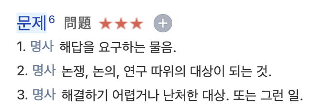
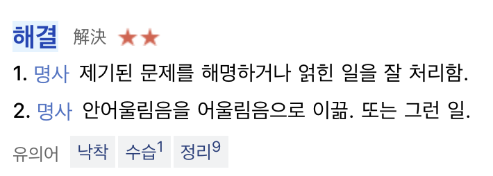
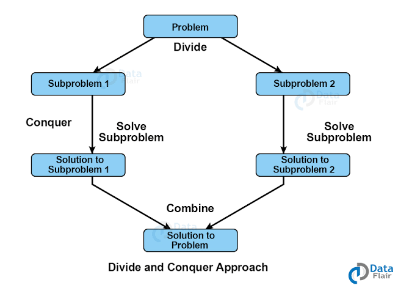

# '문제 해결'

요새 나는 ‘문제 해결’이라는 말에 꽂혀 있다. 뉴스에서도, 채용 공고에서도, CEO들의 인터뷰에서도 자주 듣는 말이다. 그 말을 들을 때마다 대략 무슨 뜻인지는 알 것 같다. 하지만 막상 나에게 문제 해결이 무엇인지 설명해 보라고 하면 말문이 막힌다. 귀로는 익숙하게 들리는데, 몸에는 잘 와닿지 않는다.

지금까지 나도 문제를 잘 해결하는 사람이 되고 싶다고 생각해 왔다. 하지만 내가 되고 싶다는 그 사람은 정확히 어떤 사람일까. 주어진 과제를 빠르게 끝내는 사람인지, 남들이 지나친 불편함을 발견하는 사람인지, 무엇부터 바꿔야 하는지 판단할 수 있는 사람인지 아직은 분명하지 않다.

그래서 이 두 단어를 조금 천천히 들여다보려 한다. 내가 무엇을 문제라고 부르고, 어떤 상태에 이르렀을 때 해결했다고 느끼는지부터 생각해 보자.

# 두 단어를 나누어 보면

우선 ‘문제’와 ‘해결’을 나누어 보자. 

{: style="display:block;margin-left:auto;margin-right:auto"}

사전에서 문제를 찾아보면 ‘해답을 요구하는 물음’, ‘논쟁이나 논의, 연구의 대상이 되는 것’과 같은 설명이 나온다. 읽고 나면 고개가 끄덕여진다. 무언가 답을 찾아야 하고, 들여다봐야 하는 대상. 평소 내가 문제라는 말에서 느끼던 것과 크게 다르지 않다.

{: style="display:block;margin-left:auto;margin-right:auto"}

해결은 ‘제기된 문제를 해명하거나 얽힌 일을 잘 처리함’이라고 한다. 이 설명을 함께 읽으면, 문제 해결은 답을 요구하는 대상이나 얽힌 일을 마주하고 그것을 풀어 가는 과정처럼 느껴진다.

그런데 일상에서 이 말을 쓸 때는 그렇게 또렷한 물음이 먼저 주어지지 않는 경우도 많다. 일이 잘 풀리지 않으면 “문제가 있다”고 하고, 하던 일이 막히면 “문제가 생겼다”고 한다. 친구에게 “요즘 잘 지내? 별문제 없지?”라고 묻기도 한다. 이때는 무엇이 잘못됐는지 설명하기도 전에, 어딘가 순조롭지 않다는 느낌을 먼저 말하고 있는 것 같다.

그렇다면 그 느낌은 언제부터 내 머릿속에서 하나의 문제가 되는 걸까?

# 불편함이 문제로 자리 잡기까지

내가 무언가를 문제라고 여기게 되는 순간을 떠올려 보면, 처음에는 막연한 불편함이 있다. 무언가 막혀 있는 느낌, 이대로 두기에는 자꾸 마음에 걸리는 느낌이다. 처음부터 그 이유를 정확하게 아는 것은 아니다. 그냥 하던 대로 넘어가 보려다가도 같은 지점에서 다시 멈칫하게 된다.

그러다 어느 순간 그 불편함을 의식한다. 무엇이 나를 답답하게 하는지 생각하고, 왜 이런 일이 반복되는지 묻게 된다. 그때부터 그것은 머릿속에 자리를 잡는다. 다른 일을 하다가도 떠오르고, 언젠가는 손을 대야 할 과제처럼 남는다.

지금의 내 언어로 정리하면 ‘불편함 → 인지 → 과제’에 가깝다. 다만 이것이 모든 문제가 생겨나는 순서라고 말할 수는 없다. 내가 지금 떠올릴 수 있는, 나에게 문제가 생기는 과정이 그렇다는 뜻이다.

그렇게 불편함이 하나의 과제가 되고 나면, 이제는 무엇을 어떻게 바꿔야 할지 생각하게 된다. 하지만 마음에 걸리는 일이 있다는 걸 알아차려도 어디서부터 손을 대야 할지는 여전히 막막하다. 

# 나는 문제를 어떻게 풀어 왔을까?

내가 일상에서 자주 마주하는 문제를 예로 들어 보자. 친구나 이성과의 관계에서 생기는 갈등이다.

돌아보면 이런 관계에서 내가 겪는 문제는 대부분 내 말버릇에서 비롯되곤 했다. 무심코 꺼낸 말이 상대를 불편하게 하거나, 전하려던 뜻과 다르게 받아들여지는 식이다. 그럴 때면 내가 했던 말을 곱씹으며 어디에서 문제가 생겼는지 살펴본다.

처음에는 그저 ‘내 말 때문에 관계가 틀어졌다’는 하나의 큰 문제로 느껴진다. 하지만 이 상태로는 무엇부터 바꿔야 할지 막막하다. 그래서 당시의 대화를 조금씩 나누어 들여다본다. 무슨 말을 했는지, 어떤 표현과 말투를 썼는지, 상대는 그 말을 어떻게 받아들였는지 하나씩 짚어 보는 것이다.

이렇게 나누고 나면 내가 손댈 수 있는 부분이 보이기 시작한다. 예를 들어 표현이 거칠었다면 같은 뜻을 다른 말로 전할 방법을 찾을 수 있다. 설명이 부족해 오해가 생겼다면 빠뜨린 맥락을 전할 수 있다. 상대의 의도를 내 마음대로 단정했다면, 그 부분을 다시 물어볼 수 있다. 막연했던 하나의 문제가 각각 답을 찾아볼 수 있는 작은 문제들로 바뀐다.

각각의 답이 곧바로 관계 전체를 회복시키는 것은 아니다. 다만 잘못 전해진 뜻을 바로잡고, 이해하지 못했던 부분을 확인하고, 갈등을 만든 말버릇을 고치는 일이 함께 이루어지면서 처음의 문제도 풀려 간다. 하나씩 찾아낸 해결책들이 서로 이어져야 비로소 큰 문제의 해결에 닿게 되는 것이다.

이 과정을 돌아보니 익숙한 알고리즘 하나가 떠오른다. 분할 정복이다.

{: style="display:block;margin-left:auto;margin-right:auto"}

분할 정복은 하나의 문제를 더 작은 문제들로 나누고, 각각을 해결한 뒤 그 결과를 합쳐 원래 문제의 답을 구하는 방식이다. 내가 관계라는 작은 예시에서 생긴 문제를 풀어 가던 과정도 이와 닮아 있었다. 처음에는 하나로 뭉쳐 있던 갈등을 나누어 살피고, 각 부분에서 해결책을 찾은 뒤, 그 해결책들을 모아 처음 마주했던 문제를 풀어 갔다.

# 문제와 해결의 첨예한 겹침

이쯤 되니 문제와 해결이라는 두 단어가 생각보다 많이 겹쳐 있다는 생각이 든다. 문제를 잘게 나누고 들여다보는 동안, 나는 무엇이 문제인지 조금씩 알게 됐다. 그러면서 무엇을 바꿔야 할지도 보이기 시작했다. 돌아보면 문제를 알아 가는 과정에서 이미 해결의 방법도 찾고 있었던 것 같다.

앞의 예시도 그렇다. 그냥 ‘관계가 틀어졌다’고 생각할 때는 막막했다. 하지만 내가 어떤 말을 했고, 그 말이 왜 상대를 불편하게 했는지 하나씩 짚어 보면 내가 해야 할 일이 보인다. 처음에 막연하게 느꼈던 문제를 구체적으로 설명할 수 있게 되면서, 어디에 손을 대야 할지도 알게 되는 것이다.

그렇다면 문제 해결 역량은 문제를 잘 정의하는 능력과도 닮아 있지 않을까? 무엇을 풀어야 하는지 정확히 알수록 해결할 방법도 더 구체적으로 생각할 수 있을 테니 말이다. 그래서 지금의 나는 이렇게 말하고 싶다. 문제를 잘 해결하는 사람은 문제를 잘 정의하는 사람이라고.

그러면 또 질문이 생긴다. 문제는 어떻게 잘 정의할까? 아무래도 여기에 필요한 것은 공감력인 것 같다. 앞에서는 내가 느끼는 불편함에서 출발했다. 그런데 내 주변 사람들, 더 나아가 많은 사람이 겪는 문제를 알려면 내가 직접 겪지 않은 불편함도 이해할 수 있어야 할 것 같다.

나에게는 별일 아닌 것이 누군가에게는 매일 겪는 어려움일 수 있다. 나는 그냥 지나치는 지점에서 누군가는 계속 막히고 있을 수도 있다. 그 사람이 왜 불편한지 들어 보고, 그 입장에서 생각해 봐야 내가 보지 못했던 부분도 조금씩 알게 되지 않을까.

그렇게 생각하면 문제를 잘 정의하는 일은 누군가의 불편함에 관심을 갖는 데서 시작하는 것 같다. 나뿐만 아니라 내 주변 사람들, 더 많은 사람이 겪는 불편함을 느껴 보는 것. 그리고 그 불편함이 어디에서 오는지 알아 가는 것. 아무래도 잘 알려면 먼저 잘 느껴야 하는 것 같다.

# 기술자로서 가져야하는 태도

그렇다면 기술자가 되고 싶은 나는 이 공감력을 어떻게 길러야 할까? 아무래도 기술 밖의 것들도 더 많이 알아야 할 것 같다. 인문, 사회, 예술 같은 분야에서 어떤 이야기가 오가는지, 사람들의 생활과 문화가 어떻게 달라지는지에도 더 관심을 가져 보려 한다. 사람들이 무엇을 겪고 있는지 알아야 그 불편함도 이해할 수 있을 테니 말이다.

돌아보면 기술에 관심을 두는 동안 놓치고 온 것들이 꽤 있는 것 같다. 어떤 기술로 어떻게 만들지부터 생각하다 보면, 정작 누가 왜 그것을 필요로 하는지는 충분히 들여다보지 못하기도 한다. 아직 내가 아는 것도 적고, 너무 가까운 곳만 보고 있었던 건 아닌가 하는 생각이 든다.

그래서 기술적으로 해결할 방법을 찾기 전에, 그 문제가 어떻게 생겼는지부터 알아보는 습관을 들이고 싶다. 누가 어떤 상황에서 불편함을 느끼는지 듣고, 내가 생각한 문제가 그 사람이 겪는 문제와 같은지도 살펴보는 것이다. 앞에서 말한 공감도 이런 데서부터 연습할 수 있지 않을까.

기술을 배우면서도 그 기술이 쓰일 사람들의 삶을 더 많이 들여다보고 싶다. 자꾸 기술적인 방법부터 떠올리는 나에게, 조금 더 넓게 보고 조금 더 멀리 보라는 말을 해 주고 싶다.

# 본질은 승리한다

문제 해결이라는 말을 생각하다 보면, 결국 본질이라는 말에도 닿게 된다. 무엇이 잘못됐는지 충분히 들여다보지 않은 채 무언가를 바꾸고, 그것을 해결이라고 부르고 있지는 않은지 마음에 걸리기 때문이다.

요즘은 본질을 들여다보는 데 충분한 시간을 쓰고 있는지 의문이 든다. 잘 꾸며진 말에 가려 정작 중요한 것이 흐려지기도 하고, 좋은 생각이나 노력이 제대로 표현되지 못했다는 이유로 쉽게 지나쳐지는 것 같아 속상하다.

물론 생각을 잘 전달하는 일도 중요하다. 다만 설명을 듣고 납득했다는 느낌과, 실제로 무엇인가 나아졌다는 사실 사이에는 거리가 있을 수 있다. 나 역시 그럴듯한 설명을 찾은 뒤에 더 묻기를 멈춘 적은 없었는지 의문이 든다.

‘본질은 승리한다’는 말을 쓰고 싶었다. 그런데 적어 놓고 보니, 세상이 늘 그렇게 움직인다고 확신해서 쓰는 말은 아닌 것 같다. 내가 중요하다고 여기는 것을 쉽게 놓치고 싶지 않아서, 스스로에게 해 주고 싶은 말에 가깝다.

지금은 그 본질이 무엇인지부터 더 생각해 보고 싶다. 내가 해결했다고 말하는 순간에 실제로 무엇이 달라졌는지 돌아보면서.
